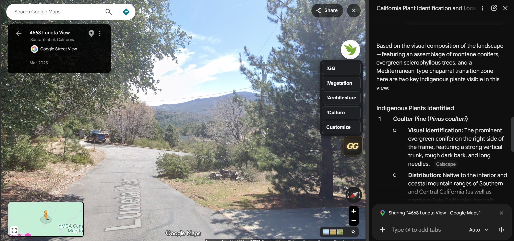

# Street View Quick Keys

A Chrome/Edge Manifest V3 extension that displays a floating quick-key menu only while Google Maps is in Street View. The menu entries default to `quick_keys.md`; each line uses `label: prompt`. Clicking a label copies its prompt to the clipboard.

When you invoke "Ask Gemini" or Google Lens Search, you may conveniently paste these prompts to the search box.
Preset prompts ask about general Geoguessr clues (!GG), plant identification (!Vegetation), architectural features (!Architecture), and cultural elements (!Cultural). Of course, you may customize your own as you wish. 

Let's explore the world. 

## Install

1. Open `chrome://extensions` (or `edge://extensions`).
2. Turn on **Developer mode**.
3. Choose **Load unpacked** and select this folder.
4. Open Google Maps and enter Street View.

Use **Customize** in the menu to edit the `label: prompt` entries. Changes are saved in the browser profile and update open Street View tabs immediately. **Restore quick_keys.md defaults** discards those custom changes and reloads the packaged file's contents. The packaged `quick_keys.md` itself is read-only to a browser extension.

The floating gold **GG** button starts at the right side, vertically centered in the Street View frame. Drag it to reposition it within that frame; if the frame resizes or panels open, the button is moved back inside the visible Street View area. Its position is saved in the current browser profile. The menu opens on hover or when the button is clicked. Click the button again to close a click-pinned menu.
